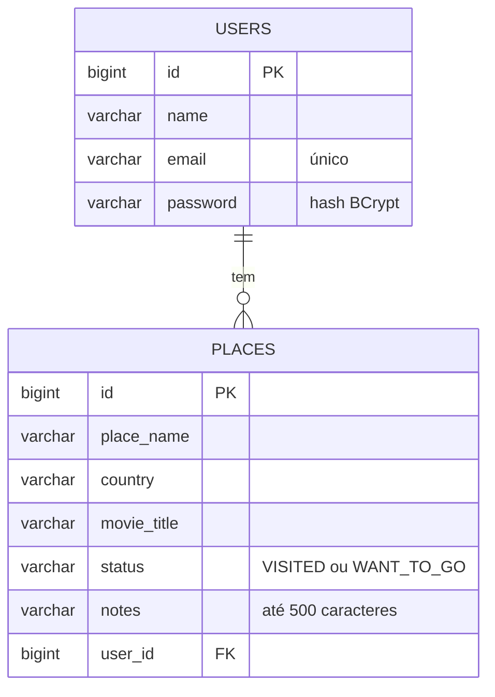

<div align="center">


# Maria vai com as outras

**Os lugares dos filmes que me levaram a viajar.**
Um app para registrar onde já fui e onde quero ir, com o filme ou a série que inspirou cada viagem.


</div>

---

## Sobre

Cada lugar guarda o **filme ou a série que me levou até lá**. Os lugares ficam em duas listas:

- **Já fui:** com uma observação e duas fotos, a minha no lugar e a cena do filme.
- **Quero ir:** com o motivo de querer ir e a cena do filme que despertou a vontade.

> Projeto P3 (Sistema): aplicação mobile com React Native no front-end e Spring Boot no back-end.

<!--
## Capturas de tela

| Login | Meus lugares | Detalhes | Novo lugar |
|---|---|---|---|
|  |  |  |  |
-->

## Integrante

| Nome completo | RM |
|---|---|
| Fernanda Maria de Souza | RM 1142823560  |

## Funcionalidades

- Cadastro e login de usuários, com autenticação JWT
- Lista de lugares em duas abas: **Já fui** e **Quero ir**
- Cadastro, consulta, edição e exclusão de lugares
- Fotos guardadas no celular: minha foto e cena do filme em "Já fui", só a cena do filme em "Quero ir"
- Sessão mantida ao fechar o app: o token fica salvo no celular

## Tecnologias

| Parte | Tecnologias |
|---|---|
| Front-end | React Native, Expo, React Navigation, AsyncStorage, expo-image-picker, JavaScript |
| Back-end | Java 17, Spring Boot 3, Spring Security, JWT (jjwt), Spring Data JPA, Bean Validation |
| Banco de dados | H2 (relacional), salvo em arquivo |

## Requisitos da P3

| Requisito | Onde está |
|---|---|
| Pelo menos 5 telas, incluindo login | Login, Cadastro, Meus lugares, Detalhes e Formulário de lugar |
| Navegação e transição entre telas | React Navigation (pilha) em `frontend/App.js` |
| Autenticação com JWT no Spring Boot | `backend/.../security` (`JwtService`, `JwtFilter`, `SecurityConfig`) |
| Comunicação por API REST | `frontend/src/api.js` e `frontend/src/placeService.js` |
| Gerenciamento de estado | `AuthContext` (`frontend/src/AuthContext.js`) |
| AsyncStorage | Sessão (token) e fotos dos lugares |
| Banco de dados relacional | H2 com as tabelas `users` e `places` (veja a [modelagem](#modelagem-do-banco)) |
| Cadastro, consulta, atualização e exclusão | CRUD de lugares em `PlaceController` |

## Modelagem do banco

Duas tabelas: um usuário tem vários lugares (1 para N). As fotos não ficam no banco, e sim no celular.



## Como executar

### 1. Back-end

Requisitos: JDK 17 ou superior.

1. Abra a pasta `backend` no IntelliJ IDEA.
2. Aguarde o Maven baixar as dependências.
3. Execute a classe `CineViagensApplication`.
4. A API fica em `http://localhost:8080`.
5. Opcional: o banco pode ser consultado em `http://localhost:8080/h2-console` (JDBC URL `jdbc:h2:file:./data/cineviagens`, usuário `sa`, senha vazia).

O banco é criado sozinho na primeira execução, na pasta `backend/data`.

### 2. Front-end

Requisitos: Node.js (LTS) e o app **Expo Go** no celular. O celular e o computador devem estar na **mesma rede Wi-Fi**.

```bash
cd frontend
npm install
```

Em `frontend/src/api.js`, troque `SEU-IP` pelo IP do computador na rede local (no Windows, use `ipconfig`):

```js
export const BASE_URL = 'http://SEU-IP:8080';
```

```bash
npx expo start
```

Leia o QR code com o Expo Go.

## API

| Método | Rota | Descrição | Autenticação |
|---|---|---|---|
| POST | `/auth/register` | Cria a conta e devolve o token | Não |
| POST | `/auth/login` | Faz login e devolve o token | Não |
| GET | `/places?status=` | Lista os lugares (`VISITED` ou `WANT_TO_GO`) | Sim |
| POST | `/places` | Cria um lugar | Sim |
| PUT | `/places/{id}` | Atualiza um lugar | Sim |
| DELETE | `/places/{id}` | Exclui um lugar | Sim |

Cada usuário só enxerga e altera os próprios lugares.

## Estrutura

```
backend/   API Spring Boot (controller, dto, model, repository, security)
frontend/  App React Native
  App.js           navegação
  src/api.js       única função que usa fetch
  src/AuthContext  estado de login
  src/screens      uma tela por arquivo
  src/components   Button, Field, KeyboardScroll, PhotoBox
```

## Observações

- As fotos ficam apenas no celular (AsyncStorage guarda o endereço da imagem). Em outro aparelho, os lugares aparecem sem as fotos.
- O token JWT vale por 24 horas. Depois disso, o app volta para a tela de login.
- O H2 Console está liberado apenas para desenvolvimento. Em produção essa rota seria removida e o banco trocado por MySQL ou PostgreSQL.